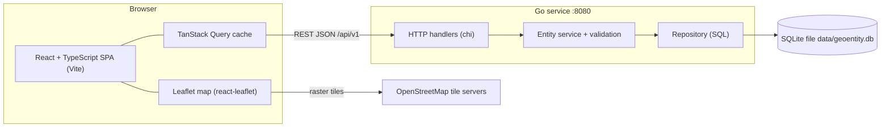
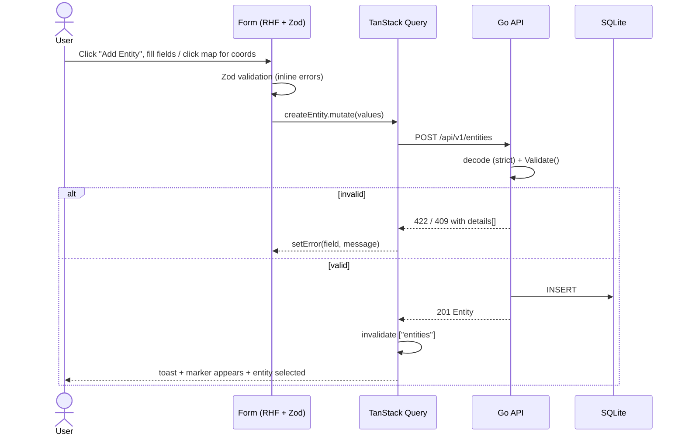

# Architecture and Technical Decisions

## 1. Overview



- The **frontend** owns presentation and UX validation.
- The **backend** owns the truth: validation, persistence and IDs/timestamps.
- In dev, Vite proxies `/api` → `:8080`. In the Docker setup, nginx serves the built SPA and proxies `/api`.

## 2. Repository layout (planned)

```
geoentity-manager/
├── AGENT.md                    # rules for AI agents (required by brief, S-6)
├── README.md                   # run instructions, library rationale, AI workflow, limitations
├── docker-compose.yml          # optional one-command run (phase 6)
├── docs/                       # this folder
├── references/                 # brief PDF + mockup PNG (read-only)
├── backend/
│   ├── go.mod
│   ├── cmd/server/main.go      # config, wiring, graceful shutdown
│   └── internal/
│       ├── config/             # env parsing (PORT, DB_PATH, CORS_ORIGINS, SEED)
│       ├── entity/             # domain: model.go, validate.go, service.go, repository.go (interface), errors.go
│       ├── storage/sqlite/     # open DB, migrations (embedded .sql), seed, repository impl
│       └── httpapi/            # router.go, handlers.go, middleware.go, respond.go (error envelope)
└── frontend/
    ├── package.json
    ├── vite.config.ts          # /api proxy
    └── src/
        ├── main.tsx, App.tsx
        ├── api/                # fetch client, ApiError type, entity endpoints
        ├── features/entities/
        │   ├── schema.ts       # Zod schema mirroring DATA_MODEL.md
        │   ├── hooks.ts        # useEntities, useCreateEntity, useUpdateEntity, useDeleteEntity
        │   ├── constants.ts    # type/status labels, colours, icons
        │   └── components/     # EntityList, EntityMap, EntityMarker, EntityDetailPanel,
        │                       # EntityFormDialog, DeleteConfirmDialog, StatusBadge, StatusCounters, MapLegend
        ├── components/         # layout shell (Header, NavRail), generic UI primitives
        └── lib/                # formatters (dates, coords), utils
```

### Backend layering

`httpapi` → `entity.Service` → `entity.Repository` (interface) ← `sqlite.Repository` (implementation)

- `entity` has **no** HTTP or SQL imports, so it is unit-testable with an in-memory fake.
- Validation lives in `entity.Validate(input) []FieldError`. It is called by the service on create and update.
- Errors are typed sentinels (`ErrNotFound`, `ErrConflict`, `*ValidationError`). They are mapped to HTTP codes in **one** place (`respond.go`).

## 3. Technology choices and rationale

### Backend (Go)

| Concern | Choice | Why | Alternatives considered |
|---|---|---|---|
| Router | **go-chi/chi v5** | Idiomatic `net/http` compatible, path params, middleware ecosystem. Works on Go 1.21 (stdlib method/path patterns need 1.22+) | stdlib `ServeMux` (needs Go ≥ 1.22), Gin/Echo (heavier, non-stdlib handler signatures) |
| CORS | **go-chi/cors** | Small and maintained; pairs with chi | Hand-rolled middleware |
| Database | **SQLite** | Zero setup for reviewers, single file, real SQL with constraints, persists across restarts | PostgreSQL + PostGIS (more power, but adds a server or Docker requirement); in-memory map (fails "stored" spirit) |
| SQLite driver | **modernc.org/sqlite** | **Pure Go, no CGO**, so it builds on Windows without a C toolchain | mattn/go-sqlite3 (needs CGO/gcc) |
| Migrations | Embedded `.sql` files via `embed` + tiny runner (`schema_migrations` table) | No extra dependency for 1–2 migrations | golang-migrate, goose |
| IDs | **google/uuid** | Standard, tiny | Auto-increment ints (leak counts, less portable) |
| Validation | **Hand-written** `Validate()` | Rules are few. Explicit code is easy to review, and messages match the frontend exactly | go-playground/validator (struct tags, harder to give custom per-field messages) |
| Logging | **log/slog** (stdlib) | Structured, no dependency | zap, zerolog |
| Tests | stdlib `testing` + `net/http/httptest` | No dependency | testify |

### Frontend (React + TypeScript)

| Concern | Choice | Why | Alternatives considered |
|---|---|---|---|
| Build tool | **Vite** | Fast dev server, first-class TS, simple proxy | CRA (deprecated), Next.js (SSR unnecessary) |
| Map library | **Leaflet + react-leaflet** | Free, no API key, mature, lightweight; draggable markers and `divIcon` cover the mockup's custom pins | MapLibre GL (vector tiles need a style provider), Google Maps / Mapbox (API keys, billing) |
| Map tiles | **OpenStreetMap** standard tiles (attribution shown) | Matches mockup credit; no key | CARTO light basemap (nice-to-have in layers toggle) |
| Server state | **TanStack Query** | Caching, loading and error states, mutation + invalidation. Removes hand-written fetch state | Redux Toolkit Query, SWR, plain `useEffect` |
| UI/client state | **React state + URL search params** (`?selected=<id>`) | Little global state exists; the URL makes the selection shareable or reloadable | Zustand / Redux (unneeded complexity) |
| Forms | **react-hook-form** | Performant, minimal re-renders, `setError` for server errors | Formik |
| Client validation | **Zod** + `@hookform/resolvers` | One typed schema gives both validation and inferred TS types | Yup |
| Styling | **Tailwind CSS** | Fast to match the mockup's spacing and colours; no CSS naming overhead | CSS Modules, MUI (heavier, harder to match mockup) |
| Icons | **lucide-react** | Mockup uses Lucide-style line icons | Heroicons |
| Dialogs / toasts | Small local components (native `<dialog>`) + **sonner** for toasts | Minimal deps, accessible enough for scope | Radix UI / shadcn (can be adopted if time allows) |
| Tests | **Vitest** + **@testing-library/react** | Vite-native, Jest-compatible API | Jest |

> Exact versions are pinned at implementation time and recorded in `go.mod` / `package-lock.json`. The README "Library choices" section is generated from this table.

## 4. Key UI flows



- **Select:** marker click or list click → `?selected=id` → detail panel opens, map pans to marker, and the marker is highlighted.
- **Edit:** detail panel "Edit" → form dialog prefilled. While editing, the selected marker becomes draggable and drag-end writes lat/lng into the form.
- **Delete:** "Delete" → confirm dialog → `DELETE` → invalidate, clear selection, toast.
- **Errors:** network failure → toast + retry. List load failure → inline error state with a retry button. Empty state → "No entities yet" CTA.

## 5. Configuration

| Var | Default | Used by |
|---|---|---|
| `PORT` | `8080` | backend |
| `DB_PATH` | `./data/geoentity.db` | backend (directory auto-created) |
| `CORS_ORIGINS` | `http://localhost:5173` | backend (comma-separated) |
| `SEED` | `true` | backend: seed mockup data if the table is empty |
| `VITE_API_BASE_URL` | `` (same origin, `/api`) | frontend |

## 6. Environment notes (this workstation)

Detected while planning: Go **1.21.1**, Node **22.19.0**, npm **10.9.3**, Git **2.45.1**, Docker **28.4.0**.

> [!WARNING]
> Go 1.21 has no stdlib method-based routing (hence chi). Recent `modernc.org/sqlite` releases may declare a newer `go` directive in their `go.mod`. During phase 1, either pin a driver version compatible with Go 1.21, or upgrade the toolchain (Go ≥ 1.22). The decision is recorded in the README.

## 7. Testing strategy

| Layer | What | Tool |
|---|---|---|
| Go domain | Table-driven tests for every rule in DATA_MODEL.md §2 (boundaries: ±90, ±180, lengths, enums, trimming, 0 coords) | `testing` |
| Go repository | CRUD against a temp-file SQLite DB; unique `code` → conflict | `testing`, `t.TempDir()` |
| Go HTTP | Status codes and envelopes for each endpoint: malformed JSON, unknown field, bad UUID, 404, 409, 422 | `httptest` |
| Frontend schema | Same boundary cases as Go (keeps parity) | Vitest |
| Frontend components | Form shows errors; server `422` mapped to fields; detail panel renders entity | Vitest + Testing Library |
| Manual E2E | Checklist in IMPLEMENTATION_PLAN.md §Verification | Browser |
